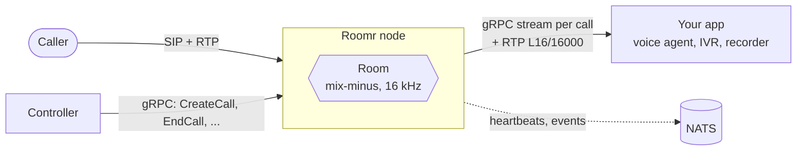

<a href="https://github.com/fonoster/roomr"></a>

[](https://github.com/fonoster/roomr/actions/workflows/ci.yaml) [](https://github.com/fonoster/roomr/releases) [](https://hub.docker.com/r/fonoster/roomr) [](https://discord.gg/4QWgSz4hTC) 

# Real-time audio streams for voice AI.

Roomr is a small, fast node, written in Go, that does the parts of telephony a voice agent should
never have to: it terminates SIP calls, puts the people and agents on a call in a **room** that
mixes their audio, and streams each call to your app over **RTP** with a **per-call gRPC control
stream**. Your app stays a normal service that speaks gRPC and RTP. It never touches SIP.

Roomr is the media edge of [Fonoster](https://github.com/fonoster/fonoster), and it is built to be
used on its own.



## Why Roomr

- **Rooms, not calls.** A caller, an agent, a supervisor and a recorder are participants in one
  room. Everyone hears everyone except themselves (mix-minus). Warm transfers, whispers and
  recording are just participants joining and leaving.
- **Your app never sees SIP.** It gets a gRPC stream per call and plain 16 kHz linear audio. Write
  it in any language.
- **Wideband by default.** Opus, G.722, PCMU and PCMA on the phone leg, mixed at 16 kHz.
- **Small and boring to run.** One static binary, one YAML file, one image of about 30 MB.
  Nodes share nothing; add more behind your proxy.
- **Built for failure.** NATS is best effort and never required to run a call. Draining is a health
  signal. Calls end with a precise cause.
- **Specified and proven.** Behavior is written as requirements with scenarios in
  [`openspec/`](openspec), and tests are named after them.

## Quick start

```sh
# 1. a config
cat > roomr.yaml <<'YAML'
nodeId: node-a
sip:     { listen: 0.0.0.0:5060, advertise: 192.0.2.10 }
rtp:     { advertise: 192.0.2.10, portMin: 30000, portMax: 30199 }
control: { grpc: { listen: 0.0.0.0:50061 } }
sessionEndpoint: 192.0.2.20:50070     # your app: where each call's stream goes
YAML

# 2. a node
docker run --rm --network host -v "$PWD/roomr.yaml:/config/roomr.yaml:ro" fonoster/roomr

# 3. a call (from your controller, or any gRPC client)
grpcurl -plaintext -d '{"call_ref":"c1","to":{"uri":"sip:+15551234567@carrier.example"}}' \
  localhost:50061 roomr.v1.Roomr/CreateCall
```

Next: [write the app and the controller](docs/INTEGRATE.md).

## Documentation

| | |
| --- | --- |
| [How it works](docs/ARCHITECTURE.md) | Purpose, pieces, call flows, media path, failure model, with diagrams |
| [The contract](docs/CONTRACT.md) | The two gRPC interfaces, RTP and NATS, field by field |
| [Integrate](docs/INTEGRATE.md) | Run a node, write an app and a controller, test with the fake |
| [Configuration](docs/CONFIGURATION.md) | Every `roomr.yaml` setting, ports, draining, codecs |
| [Specs](openspec/specs) | The requirements, with scenarios |
| [`llms.txt`](llms.txt) | An index for AI tools |

## Build from source

```sh
brew install opus   # or: apt install libopus-dev
go build ./cmd/...
go test ./cmd/... ./internal/...
./roomr -config examples/roomr.compose.yaml
```

End-to-end tests (`go test ./e2e/...`) need Docker and NATS; see [CONTRIBUTING.md](CONTRIBUTING.md).

## Compatibility

| Roomr | Fonoster |
| --- | --- |
| 0.1.x | main (October 2026) |

## Community

We build in the open. Ask questions and share ideas in
[GitHub Discussions](https://github.com/fonoster/roomr/discussions), report bugs and request
features in [issues](https://github.com/fonoster/roomr/issues), and read
[CONTRIBUTING.md](CONTRIBUTING.md) before sending a pull request. Security issues go to
[SECURITY.md](SECURITY.md).

## License

[MIT](LICENSE), by [Fonoster Inc](https://fonoster.com).
