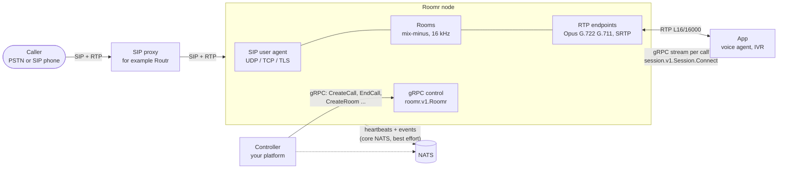
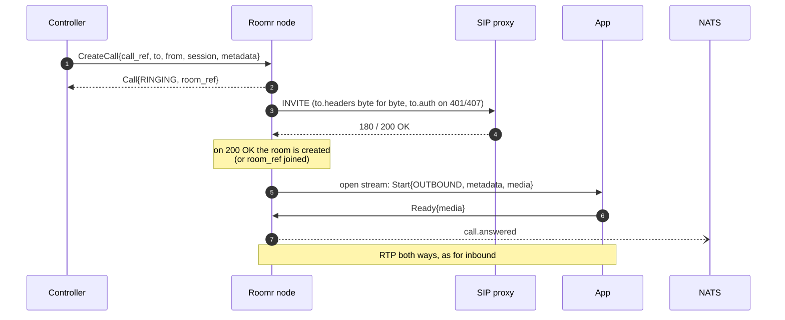
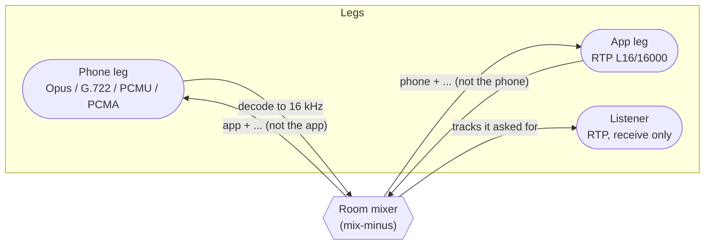
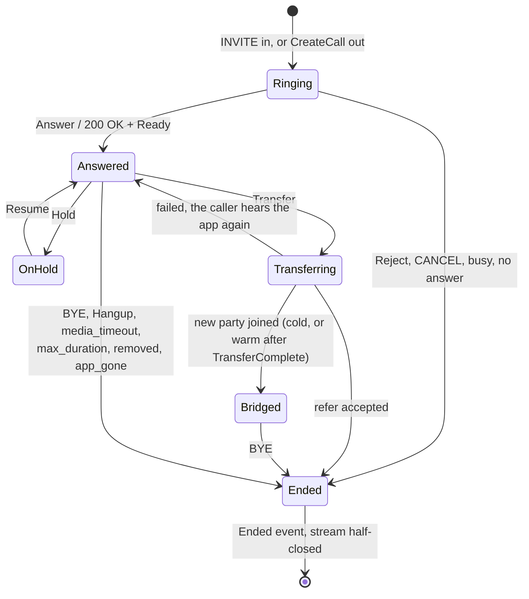
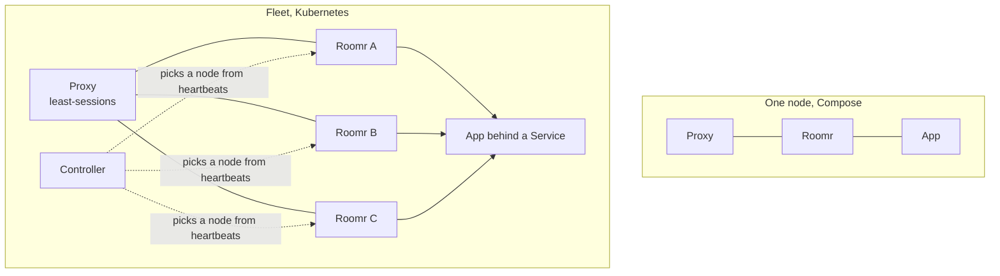

# How Roomr works

This is the high-level map. It is written to be read by people and by AI tools, so every diagram is
text (Mermaid) and every claim points at the place that proves it. For field-level detail see
[CONTRACT.md](CONTRACT.md); to build on top of Roomr see [INTEGRATE.md](INTEGRATE.md); for every
setting see [CONFIGURATION.md](CONFIGURATION.md). The normative behavior lives in
[`openspec/specs`](../openspec/specs).

## Purpose

Roomr is the **SIP and media edge** of a voice platform. It does the parts of telephony that must
sit on the wire and nothing else:

- terminate and originate SIP calls (UDP, TCP, TLS), with Opus, G.722, PCMU and PCMA;
- put the legs of a call into **rooms** that mix audio for their participants (mix-minus, 16 kHz
  linear), so a caller, an agent and a supervisor can share one call;
- hand each call to an **app** (a voice agent, an IVR, a recorder) over a **per-call gRPC control
  stream**, with the audio as **RTP** between the node and the app;
- report what happened as **events** and **heartbeats** on NATS.

### Non-goals

Roomr is not an app server and not a platform. It does not play prompts, run speech recognition or
text to speech, record, route by tenant, authenticate API callers or store anything. An app plays
its own audio on its RTP leg, records by adding a listener, and sends DTMF on its control stream.
The one audio the node fetches itself is hold music, because only the node can play to the caller
alone. It knows no other component by name: proxy, registrars, session endpoint and header names
all come from configuration or from requests.

## The pieces



| Piece | Owns | Talks to |
| --- | --- | --- |
| **Roomr node** (this repo) | SIP legs, rooms, mixing, codecs, RTP, the per-call stream | everyone below |
| **SIP proxy** | where calls come from and go to; registrations | the node over SIP |
| **Controller** | creating calls and rooms, choosing a node, capacity | the node over `roomr.v1.Roomr`; NATS for heartbeats |
| **App** | the conversation: speech, logic, prompts | the node over `session.v1.Session` and RTP |
| **NATS** | heartbeats and events | the node publishes; controllers subscribe |

Which proxy, controller and app you use is up to you. Fonoster uses Routr, its apiserver and
AppBridge.

## An inbound call

```mermaid
sequenceDiagram
  autonumber
  participant C as Caller
  participant P as SIP proxy
  participant N as Roomr node
  participant A as App (session endpoint)

  C->>P: INVITE
  P->>N: INVITE
  N-->>P: 180 Ringing
  Note over N: caller joins a room<br/>(the sip.roomHeader room, else a new one)
  N->>A: open stream: Start{call_ref, INBOUND, from, to,<br/>headers, room_ref, media}
  A->>N: Answer{media, max_duration_s}
  N-->>P: 200 OK (SDP)
  P-->>C: 200 OK
  C-)N: RTP (caller leg)
  N-)A: RTP L16/16000 (app leg, mixed)
  A-)N: RTP L16/16000
  Note over N,A: keepalive pings every 10 s;<br/>events: ParticipantJoined, Dtmf, ...
  C->>P: BYE
  P->>N: BYE
  N->>A: Ended{cause: caller_hangup}
  N--)NATS: call.ended
```

If the app refuses, `Reject{sip_status}` becomes that SIP status. If the endpoint is unreachable the
caller gets `503`; no `Answer` within `answerTimeout` gives `480`; a `CANCEL` gives `487` and
`Ended caller_hangup`.

## An outbound call



Busy, no answer or a rejection end the call with `call.ended` (`sip_status`, `cause`) and open no
stream. `call_ref` is idempotent for ten minutes: the same parameters return the existing `Call`,
different parameters return `ALREADY_EXISTS`.

## Rooms and the audio path

A room mixes every participant's audio and gives each one **everyone except themselves**
(mix-minus). A call has a phone leg (SIP, any codec) and an app leg (RTP, L16/16000, 20 ms, payload
type 96). Listeners are extra RTP endpoints that receive the tracks they ask for and send nothing,
so recording and supervision are just listeners.



SRTP (SDES) is optional: `Start.media.srtp_key` is always set; an app that answers with its own key
gets SRTP, one that leaves it empty gets plain RTP.

## What an app can do on its stream

| Command | Effect |
| --- | --- |
| `Answer` / `Ready` / `Reject` | take an inbound call, complete an outbound one, or refuse (SIP 4xx to 6xx) |
| `Transfer` | `cold`, `warm` (music while the new party is dialed) or `refer`; result as `TransferResult` |
| `Hold` / `Resume` | silence the app and play hold music to the caller, or undo it |
| `SendDtmf` | RFC 4733 digits on the caller's leg, in order |
| `AddListener` / `RemoveListener` | fork audio by track to an RTP endpoint (recording, supervision) |
| `Hangup` | end the call with a SIP status and reason |

The node sends `Dtmf` (source `rfc4733`, `sip_info` or `inband`) and `Event`s: `ParticipantJoined`,
`ParticipantLeft`, `TransferResult` and `Ended`.

### A call's life



### How a call ends

`Ended.cause` is one of `caller_hangup`, `callee_hangup`, `busy`, `no_answer`, `rejected`,
`media_timeout`, `node_error`, `max_duration`, `removed`, `app_gone`, with `sip_status` when SIP gave
one. A silent caller leg ends as `media_timeout`; a silent app leg or a broken stream ends as
`app_gone`, and a stream is never reconnected.

## Control, events and failure

- **The control plane is gRPC**, in two directions: a controller calls the node (`roomr.v1.Roomr`)
  and the node calls each app (`session.v1.Session.Connect`, one **new** connection per call, so
  the app side scales behind any load balancer).
- **NATS is best effort and never required to run a call.** The node keeps calls, RPCs and streams
  alive while NATS is down, buffers nothing and drops events it cannot publish. Heartbeats go to
  `roomr.nodes.<node_ref>.heartbeat`, call events to `roomr.events.<call_ref>`, room events to
  `roomr.events.room.<room_ref>`. Each event has a `node_ref`, a per-call `seq` from 1 and a `ts`.
- **Only `maxRooms` refuses calls** (INVITE `503`, `CreateCall` `RESOURCE_EXHAUSTED`). CPU and memory
  never do.
- **Draining** is a health signal, not a refusal: on SIGTERM the node fails its `grpc.health.v1`
  check, unregisters, publishes `node.down`, and keeps live rooms until they end or `drainWait`
  passes.
- **Isolation is the network's job.** The node authenticates neither RPCs nor SIP sources: its SIP
  port should be reachable only from the proxy, and its control port only from the controller.

## Deployment shapes



Nodes share nothing. Nothing coordinates RTP ports between nodes: run one node per host, or give
nodes that share a host non-overlapping port ranges. The proxy spreads inbound calls (a node can
register with a session-count header for least-sessions balancing); the controller spreads outbound
ones using the heartbeats.

## Where things are in the code

| Path | What |
| --- | --- |
| `cmd/roomr` | the node binary: flags, config, wiring |
| `internal/sipua`, `sipheader`, `sdp`, `caller` | SIP: user agent, header rules, SDP, outbound dialing |
| `internal/node` | rooms, calls, the session stream, events, hold audio |
| `internal/rtpio`, `jitter`, `audio`, `dtmf` | RTP, jitter buffer, codecs and mixing, DTMF |
| `internal/control` | the `roomr.v1.Roomr` gRPC server |
| `internal/fileconfig`, `secretref`, `edgetls`, `telemetry` | config, secrets, TLS, OpenTelemetry |
| `api/` | the two protos and their generated Go |
| `e2e/` | end-to-end tests against a real SIP proxy |
| `cmd/loadgen`, `cmd/sipcaller` | load and call tools |
| `openspec/` | the specs, and the history of how they changed |
